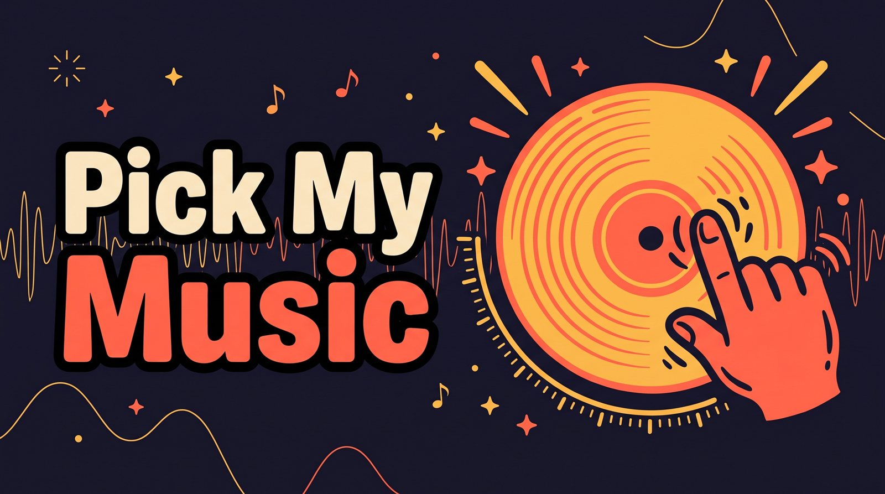

  

# Pick My Music

Imprezowa gra muzyczna w przeglądarce: **posłuchaj fragmentu utworu, zgadnij, kiedy wyszedł, i ułóż swoją oś czasu.**

## Jak grać

1. Wybierz tryb gry, wpisz graczy (jeden na linię) albo drużyny i zaznacz jedną lub kilka talii.
2. W swojej turze kliknij płytę — usłyszysz 30-sekundowy fragment (tytuł jest ukryty).
3. Wybierz miejsce na swojej osi czasu: przed, po albo między kartami, które już masz.
4. Trafisz — karta zostaje u ciebie. Pomylisz się — przepada.
5. Wygrywa ten, kto pierwszy zbierze ustaloną liczbę kart (5, 7 albo 10).

### Tryb z żetonami

Każdy zaczyna z 2 żetonami (najwyżej 5). Podasz na głos tytuł i wykonawcę przed odsłonięciem — dostajesz żeton. Żetony wydajesz na:

- **pominięcie** utworu (1 żeton),
- **przejęcie** — wskazujesz inne miejsce na osi rywala; jeśli on się myli, a ty masz rację, karta jest twoja (1 żeton),
- **kupno karty** — obecny utwór od razu ląduje na twojej osi (3 żetony).

### Drużyny

Zaznacz „Gramy w drużynach” i wpisz np. `Czerwoni: Ania, Bartek`. W każdej turze drużyny odpowiada kolejna osoba ze składu.

## Talie

| Talia | Utworów |
|---|---|
| Mix: wszystkie talie razem | 1877 |
| Polskie hity | 218 |
| Złote lata 60. i 70. | 158 |
| Lata 80. | 184 |
| Lata 90. | 193 |
| Lata 2000. | 199 |
| 2010 i później | 335 |
| Rock | 251 |
| Rap i trap USA | 172 |
| Rap i trap PL | 208 |

Lata wydania zostały sprawdzone w MusicBrainz, Deezerze i iTunes — szczegóły w [audyt-talii.md](audyt-talii.md).
Opcjonalnie można wygenerować własną talię na dowolny motyw przez Gemini (wymaga własnego klucza API, który zostaje tylko w przeglądarce).

## Funkcje

- Kilka talii naraz (np. Polskie hity + Rap PL) — bez powtórzeń utworów.
- Gra pamięta zagrane utwory i w kolejnych rozgrywkach najpierw losuje nowe.
- Przycisk „Zły rok?” przy odsłoniętym utworze — zgłoszone utwory nie wracają, a listę można skopiować i odesłać do poprawki.
- Dźwięki, animacje i konfetti dla zwycięzcy (dźwięki można wyłączyć).
- Instalacja jak aplikacja (PWA): na telefonie „Dodaj do ekranu początkowego” daje pełny ekran i własną ikonę.
- Dźwięk z iTunes, a gdy nie odpowiada — z Deezera (tylko oryginalne nagrania, bez coverów i wersji live).
- Układ dopasowany do telefonu i telewizora (tryb TV powiększa grę na dużym ekranie, nawigacja pilotem).

## Uruchomienie

To jedna strona bez serwera i bez instalacji:

- **Online:** wrzuć cały folder (razem z `grafiki/`) na GitHub Pages lub Netlify.
- **Lokalnie:** w folderze projektu uruchom `python -m http.server 8765` i otwórz `http://localhost:8765`.
  (Samo otwarcie pliku dwuklikiem może blokować pobieranie fragmentów audio.)

## Uwagi

- Fragmenty utworów to 30-sekundowe podglądy udostępniane publicznie przez iTunes i Deezer — gra niczego nie przechowuje.
- Grafiki wygenerowano w Google Gemini.
